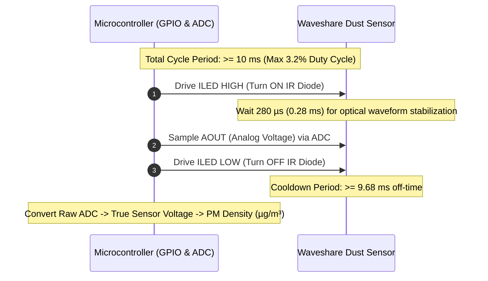
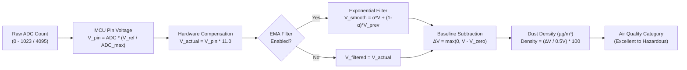

# Waveshare Dust Sensor Library

<p align="center">
  
</p>

<p align="center">
  <a href="https://opensource.org/licenses/MIT"></a>
  <a href="https://www.arduino.cc/"></a>
  <a href="https://platformio.org/"></a>
  <a href="https://github.com/"></a>
</p>

---

A lightweight, non-blocking, memory-efficient Arduino & PlatformIO library for the **[Waveshare Dust Sensor](https://www.waveshare.com/wiki/Dust_Sensor)**, powered by the **Sharp GP2Y1010AU0F** optical particulate sensing core.

Provides accurate particulate concentration readings ($\mu\text{g/m}^3$ and $\text{mg/m}^3$), automatic compensation for Waveshare's onboard $11:1$ resistor divider, built-in noise filtering, clean-air baseline calibration, and dual-mode (synchronous and non-blocking) operation.

---

## Table of Contents

* [How It Works (Datasheet Deep Dive)](#how-it-works-datasheet-deep-dive)
  * [1. Optical Scattering Principle](#1-optical-scattering-principle)
  * [2. Pulse Timing & Duty Cycle](#2-pulse-timing--duty-cycle)
  * [3. The Waveshare Breakout Board Advantage](#3-the-waveshare-breakout-board-advantage)
  * [4. Calculation & Conversion Pipeline](#4-calculation--conversion-pipeline)
* [Hardware Wiring & Pinout](#hardware-wiring--pinout)
* [Quick Start Guide](#quick-start-guide)
  * [1. Minimal Synchronous Read](#1-minimal-synchronous-read)
  * [2. Non-Blocking Multitasking Read](#2-non-blocking-multitasking-read)
* [Step-by-Step Calibration](#step-by-step-calibration)
* [Air Quality Classification](#air-quality-classification)
* [API Reference](#api-reference)
* [Troubleshooting & FAQ](#troubleshooting--faq)
* [License](#license)

---

## How It Works (Datasheet Deep Dive)

Understanding the internal physics of the **Sharp GP2Y1010AU0F** and the **Waveshare breakout module** ensures you get reliable, repeatable air quality data.

```
       ======================= SENSOR OPTICAL CHAMBER =======================
       
       [ Internal Infrared LED ]                   [ Phototransistor Detector ]
               \                                            /
                \                                          /
                 \                                        /
                  \---> [ Dust Particles (>0.8µm) ] --->/
                          (Light Scattering Event)
                          
       ======================================================================
```

### 1. Optical Scattering Principle
Inside the sensor chamber, an **Infrared Emitting Diode (IRED)** and a **Phototransistor** are positioned diagonally facing an open air passage:
* In clean air, the light from the IR diode travels forward without hitting the phototransistor, resulting in a low baseline voltage ($V_{\text{zero}} \approx 0.9\,\text{V}$ internally).
* When dust, smoke, or particulate matter ($> 0.8\,\mu\text{m}$) enters the chamber, the infrared light **scatters** off the particles and reflects directly into the phototransistor.
* The intensity of the scattered light is proportional to the particulate concentration, causing the output voltage to rise linearly up to its saturation ceiling ($\sim 500\,\mu\text{g/m}^3$).

### 2. Pulse Timing & Duty Cycle
The internal infrared diode requires a significant forward current ($\sim 20\,\text{mA}$). To prevent thermal runaway, component degradation, and excessive power draw, the Sharp datasheet mandates **pulsed operation** with a **maximum $3.2\%$ duty cycle** (period $T \ge 10\,\text{ms}$, pulse width $PW \le 0.32\,\text{ms}$):



> [!IMPORTANT]
> This library's non-blocking `update()` method enforces these microsecond timings in the background using `micros()`, ensuring the infrared diode is never driven longer than $320\,\mu\text{s}$.

### 3. The Waveshare Breakout Board Advantage
Standard bare Sharp GP2Y sensors require an external $150\,\Omega$ resistor and a $220\,\mu\text{F}$ capacitor. The Waveshare module integrates these onboard plus two critical circuits:
1. **Onboard Boost Circuit:** Allows the module to accept any input voltage from **$2.5\,\text{V}$ to $5.5\,\text{V}$** while keeping the optical chamber supplied with clean $5\,\text{V}$ power.
2. **Active HIGH Inverter (`ILED`):** Bare Sharp sensors use active-LOW drive. Waveshare incorporates an NPN transistor driver so that driving `ILED` **HIGH** turns the diode **ON**, and **LOW** turns it **OFF**.
3. **Hardware Voltage Divider on `AOUT` ($\approx 11:1$):** Because the internal amplifier can output up to $3.8\,\text{V}$, Waveshare steps down the voltage with an onboard resistor divider so that it can safely interface with 3.3V and 5V ADCs. 
   $$\mathbf{V_{\text{actual}} = V_{\text{pin}} \times 11.0}$$
   *The library handles this calculation automatically.*

---

### 4. Calculation & Conversion Pipeline



* **Nominal Sensitivity:** $0.5\,\text{V}$ per $100\,\mu\text{g/m}^3$ (slope $K = 0.005\,\text{V}/(\mu\text{g/m}^3)$).
* **Particulate Formula:**
  $$\text{Dust Density } (\mu\text{g/m}^3) = \frac{V_{\text{actual}} - V_{\text{zero}}}{0.005} = (V_{\text{actual}} - V_{\text{zero}}) \times 200$$

---

## Hardware Wiring & Pinout

```
   Waveshare Dust Sensor                      Arduino Uno / Nano
+-------------------------+                 +--------------------+
|  [VCC]  [GND] [AOUT][ILED]|                 |                    |
|    |      |     |     |  |                 |                    |
+----+------+-----+-----+--+                 |                    |
     |      |     |     +--------------------> D2   (Digital Out)  |
     |      |     +--------------------------> A0   (Analog In)    |
     |      +--------------------------------> GND  (Ground)       |
     +---------------------------------------> 5V   (Power)        |
                                             +--------------------+
```

### Wiring Table Across Microcontrollers

| Sensor Pin | Description | Arduino Uno / Nano | ESP32 (3.3V) | Raspberry Pi Pico (RP2040) | STM32 (Nucleo) |
| :--- | :--- | :--- | :--- | :--- | :--- |
| **VCC** | Power (2.5V – 5.5V) | `5V` | `5V` (or `VIN` / `3.3V`) | `VBUS` (5V) or `3V3` | `5V` or `3V3` |
| **GND** | Ground | `GND` | `GND` | `GND` | `GND` |
| **AOUT** | Analog Output | `A0` | `GPIO 34` (ADC1_CH6) | `GP26` (ADC0) | `PA0` (ADC1_IN0) |
| **ILED** | IR LED Control | `D2` | `GPIO 25` | `GP15` | `PA1` |

> [!TIP]
> **ESP32 Users:** Always use **ADC1** pins (GPIO 32–39) for `AOUT`. ADC2 pins (GPIO 0, 2, 4, 12–15, 25–27) cannot be used while WiFi is active.

---

## Quick Start Guide

### 1. Minimal Synchronous Read
Simple and intuitive for beginners and test benches:

```cpp
#include <WaveshareDustSensor.h>

const uint8_t PIN_AOUT = A0; // Connected to AOUT
const uint8_t PIN_ILED = 2;  // Connected to ILED

// Create sensor instance: (AOUT pin, ILED pin, Vref = 5.0V, 10-bit ADC = 1023)
WaveshareDustSensor dustSensor(PIN_AOUT, PIN_ILED, 5.0f, 1023);

void setup() {
    Serial.begin(9600);
    dustSensor.begin();
    
    // Enable built-in Exponential Moving Average filter to smooth optical noise
    dustSensor.enableFilter(true, 0.20f);
}

void loop() {
    if (dustSensor.read()) {
        Serial.print("Dust Concentration: ");
        Serial.print(dustSensor.getDustDensity(), 1);
        Serial.print(" ug/m3 | Category: ");
        Serial.println(dustSensor.getAirQualityString());
    }
    delay(1000); // 1 sample per second
}
```

---

### 2. Non-Blocking Multitasking Read
Recommended for production firmware, web servers, displays, or FreeRTOS:

```cpp
#include <WaveshareDustSensor.h>

WaveshareDustSensor dustSensor(A0, 2, 5.0f, 1023);

void setup() {
    Serial.begin(9600);
    dustSensor.begin();
    dustSensor.enableFilter(true, 0.25f);
    
    // Configure sampling rate: take a reading once every 1000ms (1Hz)
    // The library manages the 280us pulse and 9.68ms cooldown in the background!
    dustSensor.setSampleIntervalMs(1000);
}

void loop() {
    // update() returns true only when a fresh measurement cycle completes
    if (dustSensor.update()) {
        Serial.print("[ASYNC] Dust: ");
        Serial.print(dustSensor.getDustDensity(), 1);
        Serial.print(" ug/m3 | Air Quality: ");
        Serial.println(dustSensor.getAirQualityString());
    }

    // You can run any other code here without delays or blocking jitter!
    // e.g., handleWebRequests(), updateOLED(), checkButtons()
}
```

---

## Step-by-Step Calibration

Because individual Sharp sensors have a clean-air baseline ($V_{\text{zero}}$) ranging from $0.6\,\text{V}$ to $1.2\,\text{V}$, calibrating your specific sensor yields the highest accuracy:

1. Place your sensor in a clean, dust-free indoor area or sealed container.
2. Upload the included **[`04_ZeroCalibration.ino`](file:///c:/Users/oppyu/Downloads/Waveshare%20Library/Waveshare%20Dust%20Sensor%20Library/examples/04_ZeroCalibration/04_ZeroCalibration.ino)** sketch.
3. Open the Serial Monitor at **9600 baud** and send `'c'`.
4. The sketch averages 50 clean pulses and reports the exact baseline voltage:
   ```text
   >>> Calibration complete! Measured Baseline Voltage: 0.8842 V
   To use this in your code:
     dustSensor.setBaselineVoltage(0.8842f);
   ```
5. Add `dustSensor.setBaselineVoltage(0.8842f);` in your `setup()` function.

---

## Air Quality Classification

The library maps particulate matter (PM) concentration directly to air quality categories based on environmental health standards:

| Category Enum | Density ($\mu\text{g/m}^3$) | Density ($\text{mg/m}^3$) | Health Description |
| :--- | :--- | :--- | :--- |
| `DustAirQuality::EXCELLENT` | $0 - 35$ | $0.000 - 0.035$ | 🟢 Clean indoor air; minimal particles |
| `DustAirQuality::GOOD` | $35 - 75$ | $0.035 - 0.075$ | 🟡 Normal outdoor ambient air |
| `DustAirQuality::MODERATE` | $75 - 115$ | $0.075 - 0.115$ | 🟠 Noticeable dust or light haze |
| `DustAirQuality::POOR` | $115 - 150$ | $0.115 - 0.150$ | 🔴 Unhealthy for sensitive groups |
| `DustAirQuality::VERY_POOR` | $150 - 250$ | $0.150 - 0.250$ | 🟣 Unhealthy; smoke / pollution present |
| `DustAirQuality::HAZARDOUS` | $> 250$ | $> 0.250$ | 🟤 Hazardous air quality |

---

## API Reference

### Initialization & Configuration
| Method | Description |
| :--- | :--- |
| `WaveshareDustSensor(aoutPin, iledPin, vRef, adcMax)` | Constructor. Defaults: `vRef = 5.0f`, `adcMax = 1023`. |
| `void begin()` | Configures pin modes and pre-arms the state machine. |
| `void setVRef(float vRef)` | Sets ADC reference voltage (e.g. `3.3f` for ESP32/Pico, `5.0f` for Uno). |
| `void setAdcMax(uint16_t adcMax)` | Sets max ADC count (e.g. `1023` for 10-bit, `4095` for 12-bit). |
| `void setVoltageDividerRatio(float ratio)` | Changes divider scaling. Defaults to `11.0f`. |
| `void setSensitivity(float sensitivityVPer100ug)` | Sets optical slope. Defaults to `0.5f` ($0.5\,\text{V}/100\,\mu\text{g/m}^3$). |
| `void setBaselineVoltage(float vZeroActual)` | Sets zero-dust baseline voltage in Volts (nominal: `0.9f`). |
| `float getBaselineVoltage() const` | Returns the currently configured clean-air baseline voltage. |
| `void setSampleIntervalMs(uint32_t intervalMs)` | Sets non-blocking sampling interval (default: `1000` ms, min: `10` ms). |
| `uint32_t getSampleIntervalMs() const` | Returns the current non-blocking interval. |
| `void enableFilter(bool enable, float alpha = 0.25f)` | Enables EMA filter ($0.01 \le \alpha \le 1.0$). Lower = smoother. |
| `void resetFilter()` | Clears internal filter history. |
| `void setAdcCallback(DustSensorAdcReader customReader)` | Hooks in an external ADC callback (e.g. ADS1115). |

### Sampling & Measurements
| Method | Description |
| :--- | :--- |
| `bool read()` | Executes a synchronous measurement (blocks for $\sim 10\,\text{ms}$). |
| `bool update()` | Asynchronous tick. Call in `loop()`; returns `true` when a sample is ready. |
| `float calibrateZero(sampleCount, delayMs)` | Averages $N$ clean-air pulses to determine and store baseline offset. |

### Data Getters
| Method | Return Type | Description |
| :--- | :--- | :--- |
| `getRawADC()` | `uint16_t` | Raw integer count directly from the microcontroller ADC. |
| `getPinVoltage()` | `float` | Voltage measured directly at the MCU pin in Volts ($0 - V_{\text{ref}}$). |
| `getActualVoltage()` | `float` | Calculated internal sensor voltage ($V_{\text{pin}} \times 11$). Filtered if enabled. |
| `getRawActualVoltage()`| `float` | Raw unfiltered internal sensor voltage. |
| `getDustDensity()` | `float` | Dust concentration in micrograms per cubic meter ($\mu\text{g/m}^3$). |
| `getDustDensityMg()` | `float` | Dust concentration in milligrams per cubic meter ($\text{mg/m}^3$). |
| `isSaturated()` | `bool` | Returns `true` if reading exceeds the optical ceiling ($\ge 500\,\mu\text{g/m}^3$). |
| `getAirQuality()` | `DustAirQuality` | Categorical enum (`EXCELLENT` ... `HAZARDOUS`). |
| `getAirQualityString()` | `const char*` | Descriptive text (e.g. `"Excellent (Clean)"`). |

---

## Troubleshooting & FAQ

### Q1: Why does `getDustDensity()` read 0.0 µg/m³?
> **Answer:** If ambient air is cleaner than the default $0.9\,\text{V}$ baseline, the delta $\Delta V$ is negative and is clipped to zero to prevent negative readings. Run [`04_ZeroCalibration.ino`](file:///c:/Users/oppyu/Downloads/Waveshare%20Library/Waveshare%20Dust%20Sensor%20Library/examples/04_ZeroCalibration/04_ZeroCalibration.ino) to set your sensor's exact clean-air offset.

### Q2: Why are the readings fluctuating rapidly?
> **Answer:** Optical particle sensors are naturally sensitive to air currents and sporadic dust motes. Enable the built-in Exponential Moving Average filter:
> ```cpp
> dustSensor.enableFilter(true, 0.20f); // 0.20 provides smooth, stable readings
> ```

### Q3: Does the physical mounting orientation matter?
> **Answer:** **Yes!** According to the Sharp GP2Y1010AU0F application note, the sensor should be mounted with the **cylindrical through-hole oriented vertically**. This allows natural convection to carry dust particles through the chamber without allowing heavy dust to settle on and coat the internal optical lenses.

### Q4: Can I clean the optical chamber if dust accumulates over time?
> **Answer:** Yes. Gently blow clean, dry compressed air through the through-hole. **Never** insert cotton swabs, liquids, or solvents into the chamber, as this will damage the delicate optical collimator lenses.

---

## License

This project is licensed under the **MIT License** — see the [LICENSE](LICENSE) file for details.
