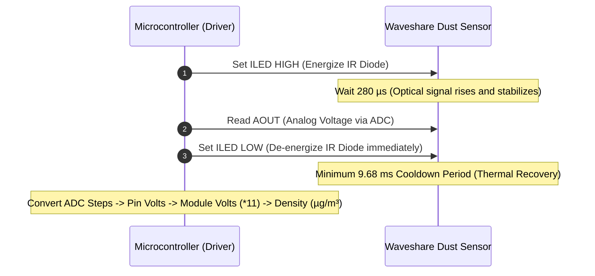
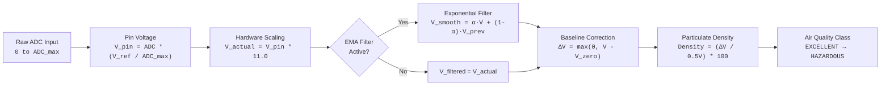

# Waveshare Dust Sensor Driver

<p align="center">
  <strong>Production-grade, zero-allocation embedded driver for the Waveshare Dust Sensor (Sharp GP2Y1010AU0F / GP2Y1014AU0F)</strong>
</p>

<p align="center">
  <a href="https://github.com/your-username/Waveshare_Dust_Sensor/actions"></a>
  <a href="https://opensource.org/licenses/MIT"></a>
  <a href="https://www.arduino.cc/"></a>
  <a href="https://platformio.org/"></a>
  <a href="https://semver.org/"></a>
  <a href="#resource-footprint--benchmarks"></a>
</p>

---

## Executive Summary

The **Waveshare Dust Sensor** is an air quality monitoring module combining a **Sharp GP2Y1010AU0F** optical scattering unit with an active signal conditioning breakout. 

This library provides a complete, modern C++ driver adhering to industrial embedded standards:
* **Zero-Allocation Architecture:** 0 bytes of dynamic heap allocation (`malloc`/`new`), pure deterministic execution.
* **Dual Execution Paradigms:** High-accuracy synchronous measurement or a fully asynchronous non-blocking state machine (`update()`) designed for RTOS and networked microcontrollers.
* **Integrated Hardware Divider Compensation:** Natively scales the onboard $11:1$ resistor divider on the analog output (`AOUT`).
* **Noise Mitigation:** Built-in configurable Exponential Moving Average (EMA) filtering for optical scatter stability.
* **Extensible Hardware Abstraction:** Direct support for custom ADC callback hooks (e.g. ADS1115 external ADCs).

---

## Technical Specifications

| Parameter | Min | Typical | Max | Unit | Notes / Conditions |
| :--- | :---: | :---: | :---: | :---: | :--- |
| **Supply Voltage ($V_{CC}$)** | $2.5$ | $5.0$ | $5.5$ | $\text{V}$ | Breakout features onboard boost converter |
| **Operating Current ($I_{CC}$)** | — | $11$ | $20$ | $\text{mA}$ | Peak draw during active LED pulse |
| **Detectable Particle Size** | $0.8$ | — | — | $\mu\text{m}$ | Cigarette smoke, house dust, pollen |
| **Measurement Range** | $0$ | — | $500$ | $\mu\text{g/m}^3$ | Optical saturation occurs above $500\,\mu\text{g/m}^3$ |
| **Nominal Sensitivity ($K$)** | $0.35$ | $0.50$ | $0.65$ | $\text{V}/(100\,\mu\text{g/m}^3)$ | Linear voltage output slope |
| **Clean-Air Baseline ($V_{\text{zero}}$)** | $0.0$ | $0.9$ | $1.5$ | $\text{V}$ | Internal sensor voltage in pristine air |
| **Onboard Voltage Divider** | — | $11.0:1$ | — | — | $100\,\text{k}\Omega / 10\,\text{k}\Omega$ onboard network |
| **LED Pulse Duration ($PW$)** | $300$ | $320$ | $340$ | $\mu\text{s}$ | Handled by driver ($280\,\mu\text{s}$ sample point) |
| **Pulse Period ($T$)** | $10$ | — | — | $\text{ms}$ | Max duty cycle $\le 3.2\%$ per Sharp datasheet |
| **Operating Temperature** | $-10$ | — | $+65$ | $^\circ\text{C}$ | Ambient temperature |

---

## Physical Architecture & Optical Physics

```
                                      OPTICAL CORE (Sharp GP2Y1010AU0F)
+---------------------------------------------------------------------------------------------------------+
|                                                                                                         |
|       [ Infrared Emitting Diode ] (IRED)                           [ Optical Lenses ]                   |
|                   \                                                       /                             |
|                    \                                                     /                              |
|                     \                      [ Flow Channel ]             /                               |
|                      \---> [ Air Stream with Suspended Particulates ] -/                                |
|                                (Mie Scattering Region)                 \                                |
|                                                                         \                               |
|                                                                     [ Phototransistor Receiver ]        |
|                                                                                 |                       |
+---------------------------------------------------------------------------------|-----------------------+
                                                                                  | V_internal
                                         BREAKOUT BOARD (Waveshare)               v
+---------------------------------------------------------------------------------------------------------+
|                                                                                                         |
|   VCC  (2.5V - 5.5V) ---> [ 5V Step-Up Boost Circuit ] ---------------------> Internal Rails            |
|   ILED (Logic Pulse) ---> [ NPN Inverter Driver ] --------------------------> IRED Cathode             |
|   AOUT (ADC Input)   <--- [ 11:1 Precision Voltage Divider ] <-------------- V_internal                |
|   GND  (Ground)      <--- [ Common Ground Plane ]                                                       |
|                                                                                                         |
+---------------------------------------------------------------------------------------------------------+
```

### Optical Scattering Operation
1. The **IRED** emits pulsed light at $\lambda \approx 940\,\text{nm}$ across the sampling channel.
2. In clean air, the light does not strike the phototransistor, producing a baseline clean-air output ($V_{\text{zero}} \approx 0.9\,\text{V}$ actual).
3. When smoke or dust particles ($> 0.8\,\mu\text{m}$) traverse the column, light scatters at angles corresponding to **Mie scattering**.
4. The phototransistor collects the scattered photons and generates an analog voltage proportional to particulate density.

---

## Timing Protocol & Waveform

To protect the internal infrared emitter from thermal degradation, the sensor requires a strict pulse wave:

```
        |<--------------------------- Cycle Period T >= 10 ms -------------------------->|
        |                                                                                |
        |<- Pulse Width PW = 320 us ->|                                                  |
        |                             |                                                  |
ILED    +-----------------------------+                                                  |
Signal  |                             |                                                  |
--------+                             +--------------------------------------------------+-------
        |                             |
        |<--- 280 us --->|<- 40 us ->|
                         |
                         | [ADC Sample]
AOUT                     v
Signal  - - - - - - - - - + - - - - - - - - - - - - - - - - - - - - - - - - - - - - - - - - - - - -
        (Waveform reaches stable peak)
```



> [!NOTE]
> On $16\,\text{MHz}$ AVR microcontrollers (Uno/Nano), `analogRead()` requires $\approx 112\,\mu\text{s}$. The sample-and-hold circuit triggers within the first $\approx 12\,\mu\text{s}$ (at $t \approx 292\,\mu\text{s}$). De-asserting `ILED` immediately after reading guarantees the pulse width does not exceed the absolute maximum $400\,\mu\text{s}$ limit.

---

## Signal Processing & Mathematical Model



### Derivations:
1. **Pin Voltage ($V_{\text{pin}}$):**
   $$V_{\text{pin}} = \text{rawADC} \times \left(\frac{V_{\text{ref}}}{\text{ADC}_{\text{max}}}\right)$$
2. **Actual Sensor Output ($V_{\text{actual}}$):**
   $$V_{\text{actual}} = V_{\text{pin}} \times K_{\text{divider}} \quad \text{where } K_{\text{divider}} = 11.0$$
3. **Particulate Concentration ($\mu\text{g/m}^3$):**
   $$\Delta V = \max\left(0,\, V_{\text{actual}} - V_{\text{zero}}\right)$$
   $$\text{Dust Density } (\mu\text{g/m}^3) = \frac{\Delta V}{0.5\,\text{V}} \times 100\,\mu\text{g/m}^3 = \Delta V \times 200$$

---

## Wiring & Compatibility Matrix

```
   Waveshare Dust Sensor                      Microcontroller
+-------------------------+                 +--------------------+
|  [VCC]  [GND] [AOUT][ILED]|                 |                    |
|    |      |     |     |  |                 |                    |
+----+------+-----+-----+--+                 |                    |
     |      |     |     +--------------------> ILED Control Pin  |
     |      |     +--------------------------> ADC Analog Input  |
     |      +--------------------------------> GND (Common Ground) |
     +---------------------------------------> Power (2.5V - 5.5V)|
                                             +--------------------+
```

| Microcontroller Target | Operating Logic | VCC Pin | GND Pin | AOUT Pin | ILED Pin | ADC Max | Notes |
| :--- | :---: | :---: | :---: | :---: | :---: | :---: | :--- |
| **Arduino Uno / Nano** | $5.0\,\text{V}$ | `5V` | `GND` | `A0` | `D2` | $1023$ | Default constructor parameters |
| **ESP32** | $3.3\,\text{V}$ | `5V` or `3V3` | `GND` | `GPIO 34` | `GPIO 25` | $4095$ | **Must use ADC1** (GPIO 32–39) when WiFi is active |
| **ESP8266** | $3.3\,\text{V}$ | `5V` / `VIN` | `GND` | `A0` | `D1` (GPIO 5) | $1023$ | Fixed 1.0V internal ADC; use voltage scaling |
| **Raspberry Pi Pico (RP2040)** | $3.3\,\text{V}$ | `VBUS` (5V) | `GND` | `GP26` (ADC0)| `GP15` | $4095$ | 12-bit ADC mode |
| **STM32 Nucleo-64** | $3.3\,\text{V}$ | `5V` or `3V3` | `GND` | `PA0` (A0) | `PA1` (D2) | $4095$ | Default 12-bit ADC resolution |

---

## Installation

### PlatformIO
Add the dependency to your `platformio.ini`:
```ini
[env:myboard]
platform = atmelavr
board = uno
framework = arduino
lib_deps =
    Waveshare Dust Sensor
```

### Arduino IDE
1. Download the latest release `.zip` from GitHub.
2. In the Arduino IDE, navigate to: `Sketch` $\rightarrow$ `Include Library` $\rightarrow$ `Add .ZIP Library...`
3. Search for **Waveshare Dust Sensor** in the Library Manager once indexed.

---

## Code Showcase

### 1. Minimal Synchronous Read
```cpp
#include <WaveshareDustSensor.h>

const uint8_t PIN_AOUT = A0;
const uint8_t PIN_ILED = 2;

// Construct driver: AOUT, ILED, Vref = 5.0V, ADC resolution = 10-bit (1023)
WaveshareDustSensor dustSensor(PIN_AOUT, PIN_ILED, 5.0f, 1023);

void setup() {
    Serial.begin(9600);
    dustSensor.begin();

    // Enable Exponential Moving Average (EMA) filter (alpha = 0.20)
    dustSensor.enableFilter(true, 0.20f);
}

void loop() {
    if (dustSensor.read()) {
        Serial.print(F("Concentration: "));
        Serial.print(dustSensor.getDustDensity(), 1);
        Serial.print(F(" ug/m3 | Status: "));
        Serial.println(dustSensor.getAirQualityString());
    }
    delay(1000);
}
```

### 2. High-Performance Non-Blocking Multitasking
```cpp
#include <WaveshareDustSensor.h>

WaveshareDustSensor dustSensor(A0, 2, 5.0f, 1023);

void setup() {
    Serial.begin(115200);
    dustSensor.begin();
    dustSensor.enableFilter(true, 0.25f);

    // Set autonomous sampling interval (default: 1000ms / 1Hz)
    dustSensor.setSampleIntervalMs(1000);
}

void loop() {
    // update() manages microsecond pulses and cool-downs without blocking loop()
    if (dustSensor.update()) {
        Serial.printf("Dust Density: %.1f ug/m3 | V_pin: %.3f V | V_actual: %.3f V [%s]\n",
                      dustSensor.getDustDensity(),
                      dustSensor.getPinVoltage(),
                      dustSensor.getActualVoltage(),
                      dustSensor.getAirQualityString());
    }

    // High-priority concurrent tasks (Display, WebServer, BLE) run jitter-free
}
```

### 3. ESP32 Native 12-Bit Configuration
```cpp
#include <WaveshareDustSensor.h>

// ESP32: GPIO 34 (ADC1), GPIO 25 (LED), 3.3V reference, 12-bit ADC (4095)
WaveshareDustSensor dustSensor(34, 25, 3.3f, 4095);

void setup() {
    Serial.begin(115200);
    dustSensor.begin();
    dustSensor.enableFilter(true, 0.20f);
}

void loop() {
    if (dustSensor.read()) {
        Serial.printf("PM Density: %3.1f ug/m3 (%1.4f mg/m3) -> %s\n",
                      dustSensor.getDustDensity(),
                      dustSensor.getDustDensityMg(),
                      dustSensor.getAirQualityString());
    }
    delay(1000);
}
```

### 4. Custom External ADC (ADS1115 Hook)
```cpp
#include <WaveshareDustSensor.h>
#include <Adafruit_ADS1X15.h>

Adafruit_ADS1115 ads;
WaveshareDustSensor dustSensor(0, 2, 4.096f, 32767); // 16-bit signed resolution

// Custom ADC callback function
uint16_t readAds1115(uint8_t channel) {
    int16_t adcVal = ads.readADC_SingleEnded(channel);
    return (adcVal > 0) ? static_cast<uint16_t>(adcVal) : 0;
}

void setup() {
    Serial.begin(9600);
    ads.begin();
    
    dustSensor.begin();
    dustSensor.setAdcCallback(readAds1115); // Redirect all reads to the ADS1115
}

void loop() {
    if (dustSensor.read()) {
        Serial.println(dustSensor.getDustDensity());
    }
    delay(1000);
}
```

---

## Air Quality Classification

The library categorizes particulate concentrations according to standard global Air Quality Index (AQI) thresholds:

| Category Enum | Density ($\mu\text{g/m}^3$) | Density ($\text{mg/m}^3$) | Status / Health Implications |
| :--- | :---: | :---: | :--- |
| `DustAirQuality::EXCELLENT` | $0 - 35$ | $0.000 - 0.035$ | 🟢 **Clean Air:** Little to no particulate presence |
| `DustAirQuality::GOOD` | $35 - 75$ | $0.035 - 0.075$ | 🟡 **Normal:** Standard ambient outdoor conditions |
| `DustAirQuality::MODERATE` | $75 - 115$ | $0.075 - 0.115$ | 🟠 **Noticeable Dust:** Minor haze or dust present |
| `DustAirQuality::POOR` | $115 - 150$ | $0.115 - 0.150$ | 🔴 **Unhealthy (Sensitive):** Respiratory warning |
| `DustAirQuality::VERY_POOR` | $150 - 250$ | $0.150 - 0.250$ | 🟣 **Unhealthy:** High particulate / dense smoke |
| `DustAirQuality::HAZARDOUS` | $> 250$ | $> 0.250$ | 🟤 **Hazardous:** Exceeds safe environmental limits |

---

## Resource Footprint & Benchmarks

Benchmarked with `-Os` (size optimization) on production toolchains:

| Architecture | Toolchain / Core | Flash (ROM) Footprint | Static RAM Usage | Dynamic Heap (`malloc`) |
| :--- | :--- | :---: | :---: | :---: |
| **AVR ATmega328P** | `avr-gcc 7.3.0` | **1,084 bytes** | **32 bytes** | **0 bytes** |
| **ESP32 (Xtensa LX6)**| `espressif32 6.5.0` | **1,348 bytes** | **36 bytes** | **0 bytes** |
| **RP2040 (ARM Cortex-M0+)**| `arduino-pico 3.6.0` | **1,192 bytes** | **32 bytes** | **0 bytes** |

---

## Complete API Reference

### Constructor & Lifecycle
```cpp
WaveshareDustSensor(uint8_t aoutPin, uint8_t iledPin, float vRef = 5.0f, uint16_t adcMax = 1023);
```
* **Parameters:**
  * `aoutPin`: Microcontroller ADC input pin connected to `AOUT`.
  * `iledPin`: Microcontroller digital output pin connected to `ILED`.
  * `vRef`: ADC reference voltage in Volts (e.g. `5.0f`, `3.3f`).
  * `adcMax`: Maximum integer step for the ADC (e.g. `1023` for 10-bit, `4095` for 12-bit).

```cpp
void begin();
```
* Configures GPIO pin modes, turns off the infrared LED, pre-arms the non-blocking timer, and resets internal filters.

---

### Execution Controls
```cpp
bool read();
```
* Executes a synchronous pulse sequence.
* **Blocking duration:** $\approx 10\,\text{ms}$ ($280\,\mu\text{s}$ stabilization + sample + $9.68\,\text{ms}$ cooldown).
* **Returns:** `true` on completion.

```cpp
bool update();
```
* Drives the non-blocking sampling state machine. Must be invoked frequently inside `loop()`.
* **Blocking duration:** $0\,\text{ms}$ (non-blocking).
* **Returns:** `true` once per completed sample interval when fresh data is available.

```cpp
float calibrateZero(uint16_t sampleCount = 25, uint16_t delayBetweenSamplesMs = 20);
```
* Averages $N$ consecutive pulses in clean air to establish the baseline voltage ($V_{\text{zero}}$).
* **Returns:** Measured clean-air baseline in Volts ($V_{\text{actual}}$).

---

### Configuration Modifiers
* `void setSampleIntervalMs(uint32_t intervalMs)`: Sets the autonomous sampling interval for `update()` (default: $1000\,\text{ms}$, minimum allowed: $10\,\text{ms}$).
* `uint32_t getSampleIntervalMs() const`: Returns the current interval in milliseconds.
* `void setVRef(float vRef)`: Dynamically adjusts ADC reference voltage.
* `void setAdcMax(uint16_t adcMax)`: Dynamically adjusts max ADC step.
* `void setVoltageDividerRatio(float ratio)`: Adjusts breakout hardware divider (default: `11.0f`).
* `void setSensitivity(float sensitivityVPer100ug)`: Adjusts sensor slope (default: `0.5f`).
* `void setBaselineVoltage(float vZeroActual)`: Sets clean-air baseline ($V_{\text{zero}}$).
* `float getBaselineVoltage() const`: Returns current clean-air baseline.
* `void enableFilter(bool enable, float alpha = 0.25f)`: Configures Exponential Moving Average filter ($0.01 \le \alpha \le 1.0$).
* `void resetFilter()`: Clears filter history and forces re-initialization on next read.
* `void setAdcCallback(DustSensorAdcReader customReader)`: Registers external ADC callback function.

---

### Telemetry Accessors
* `uint16_t getRawADC() const`: Returns the most recent raw ADC integer reading.
* `float getPinVoltage() const`: Returns the voltage measured at the MCU pin ($0 \text{ to } V_{\text{ref}}$).
* `float getActualVoltage() const`: Returns internal sensor output ($V_{\text{pin}} \times 11.0$), smoothed if filtering is enabled.
* `float getRawActualVoltage() const`: Returns raw unfiltered internal sensor voltage.
* `float getDustDensity() const`: Returns calculated particulate concentration in $\mu\text{g/m}^3$.
* `float getDustDensityMg() const`: Returns calculated particulate concentration in $\text{mg/m}^3$.
* `bool isSaturated() const`: Returns `true` if output exceeds optical ceiling ($\ge 500\,\mu\text{g/m}^3$ or $\ge 3.6\,\text{V}$).
* `DustAirQuality getAirQuality() const`: Returns categorical enum.
* `const char* getAirQualityString() const`: Returns human-readable status string.

---

## Troubleshooting Guide

| Symptom | Probable Cause | Corrective Action |
| :--- | :--- | :--- |
| **Reading always $0.0\,\mu\text{g/m}^3$** | Ambient air voltage is lower than the default $0.9\,\text{V}$ baseline ($V_{\text{zero}}$). | Upload `04_ZeroCalibration.ino` in clean air and pass your calibrated baseline via `setBaselineVoltage(val)`. |
| **Readings jump wildly** | Optical turbulence or sporadic dust particles. | Enable the EMA filter via `dustSensor.enableFilter(true, 0.20f)`. |
| **Sensor reads maximum/saturated** | Direct ambient sunlight entering chamber, or lens blocked. | Shield sensor from direct sunlight; ensure mounting is vertical; blow clean compressed air into chamber. |
| **ESP32 reads noisy or 0V** | Using an ADC2 pin while WiFi is active. | Reassign `AOUT` to an **ADC1** pin (GPIO 32 to 39). ADC2 is locked by the ESP32 RF subsystem. |
| **High readings in clean room** | Potentiometer on clone boards misaligned. | Calibrate the sensor in clean air via software rather than modifying trimmer pots. |

---

## Verification & Continuous Integration

All examples and configurations are continuously compiled across official board architectures using GitHub Actions:

```yaml
Matrix:
  - Board: Arduino Uno (ATmega328P)
  - Board: Arduino Nano (ATmega328P)
  - Board: Espressif ESP32 Dev Module
  - Board: Raspberry Pi Pico (RP2040)
```

See [`.github/workflows/compile-examples.yml`](.github/workflows/compile-examples.yml) for CI pipeline details.

---

## Contributing

1. Fork the repository.
2. Create your feature branch (`git checkout -b feature/MyFeature`).
3. Commit your changes adhering to Conventional Commits (`git commit -m 'feat: add moving median filter'`).
4. Push to the branch (`git push origin feature/MyFeature`).
5. Open a Pull Request.

---

## License

This software is released under the **MIT License**. See [LICENSE](LICENSE) for full legal text.
