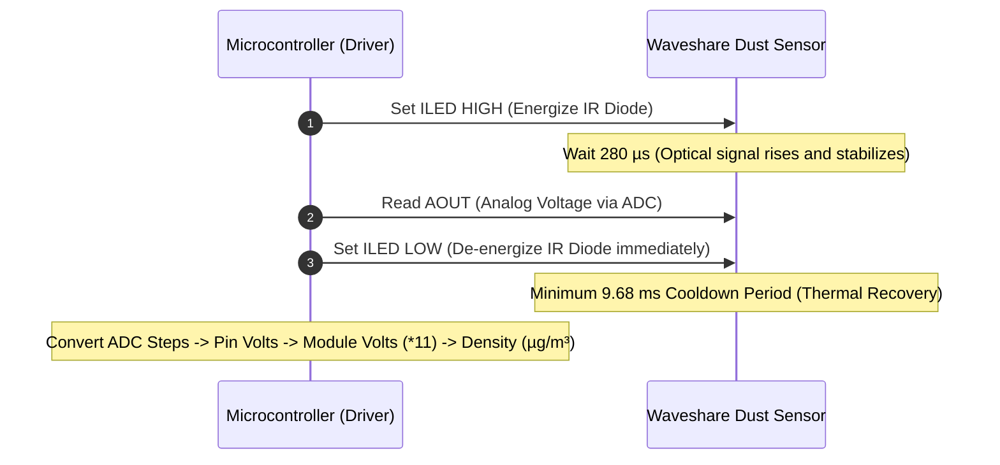
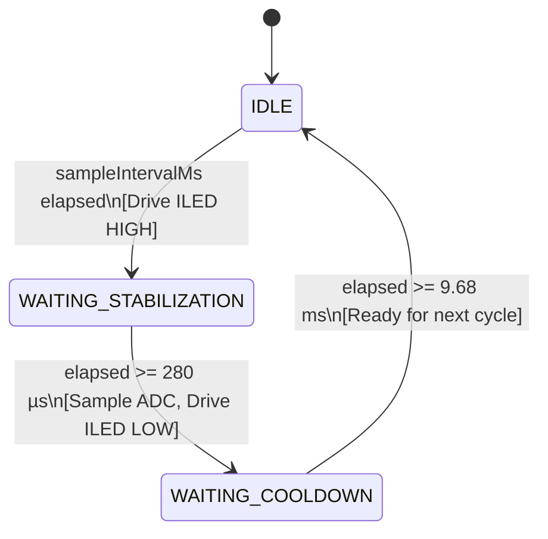
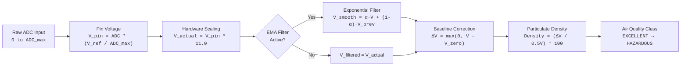

# Technical Architecture & Signal Processing

This document provides an in-depth reference for the electrical architecture, timing waveforms, state machine execution, and mathematical derivations utilized in the **Waveshare Dust Sensor** driver.

---

## 1. Physical Architecture & Optical Core

```
                                      OPTICAL CORE (Sharp GP2Y1010AU0F)
+---------------------------------------------------------------------------------------------------------+
|                                                                                                         |
|       [ Infrared Emitting Diode ] (IRED)                           [ Optical Lenses ]                   |
|                   \                                                       /                             |
|                    \                                                     /                              |
|                     \                      [ Flow Channel ]             /                               |
|                      \---> [ Air Stream with Suspended Particulates ] -/                                |
|                                (Mie Scattering Region)                 \                                |
|                                                                         \                               |
|                                                                     [ Phototransistor Receiver ]        |
|                                                                                 |                       |
+---------------------------------------------------------------------------------|-----------------------+
                                                                                  | V_internal
                                         BREAKOUT BOARD (Waveshare)               v
+---------------------------------------------------------------------------------------------------------+
|                                                                                                         |
|   VCC  (2.5V - 5.5V) ---> [ 5V Step-Up Boost Circuit ] ---------------------> Internal Rails            |
|   ILED (Logic Pulse) ---> [ NPN Inverter Driver ] --------------------------> IRED Cathode             |
|   AOUT (ADC Input)   <--- [ 11:1 Precision Voltage Divider ] <-------------- V_internal                |
|   GND  (Ground)      <--- [ Common Ground Plane ]                                                       |
|                                                                                                         |
+---------------------------------------------------------------------------------------------------------+
```

### Optical Scattering Operation
* **Emission:** An internal infrared diode emits pulsed light at $\lambda \approx 940\,\text{nm}$ across the sampling channel.
* **Scattering:** In clean air, the light does not strike the phototransistor, producing a clean-air baseline output ($V_{\text{zero}} \approx 0.9\,\text{V}$ internally). When particles ($> 0.8\,\mu\text{m}$) enter the column, light scatters at angles corresponding to **Mie scattering**.
* **Collection:** The phototransistor collects the scattered photons and generates an analog voltage proportional to particulate density.

---

## 2. Microsecond Timing Protocol

The sensor requires a pulsed driving signal on `ILED` with a maximum **$3.2\%$ duty cycle** ($PW \le 0.32\,\text{ms}$, period $T \ge 10\,\text{ms}$) to prevent IR LED thermal degradation.

### Waveform Diagram
```
        |<--------------------------- Cycle Period T >= 10 ms -------------------------->|
        |                                                                                |
        |<- Pulse Width PW = 320 us ->|                                                  |
        |                             |                                                  |
ILED    +-----------------------------+                                                  |
Signal  |                             |                                                  |
--------+                             +--------------------------------------------------+-------
        |                             |
        |<--- 280 us --->|<- 40 us ->|
                         |
                         | [ADC Sample Point]
AOUT                     v
Signal  - - - - - - - - - + - - - - - - - - - - - - - - - - - - - - - - - - - - - - - - - - - - - -
        (Waveform reaches stable peak)
```



### Microcontroller ADC Considerations
On $16\,\text{MHz}$ AVR microcontrollers (Uno/Nano), a standard `analogRead()` takes $\approx 112\,\mu\text{s}$. The internal ADC sample-and-hold circuit latches the input voltage within the first $\approx 12\,\mu\text{s}$ of the conversion (at $t \approx 292\,\mu\text{s}$, well within the $280 \pm 30\,\mu\text{s}$ window). Driving `ILED` LOW immediately after `readAdcRaw()` guarantees that the total pulse duration does not exceed the absolute maximum $400\,\mu\text{s}$ rating.

---

## 3. Non-Blocking State Machine

When using `update()`, the driver executes an asynchronous state machine tracked by microsecond timestamps (`micros()`):



1. **`State::IDLE`:** The IR LED remains powered down. The driver polls `millis()` until the user-configured `_sampleIntervalMs` has elapsed (default: $1000\,\text{ms}$).
2. **`State::WAITING_STABILIZATION`:** `ILED` is set HIGH. The driver monitors `micros()` until $280\,\mu\text{s}$ has elapsed.
3. **`State::WAITING_COOLDOWN`:** The ADC is sampled, `ILED` is immediately set LOW, physical conversions are processed, and the method returns `true`. The state machine then enforces the required $9.68\,\text{ms}$ thermal cooldown before returning to `IDLE`.

---

## 4. Signal Processing & Mathematical Derivations



### Derivations:

1. **Microcontroller Pin Voltage ($V_{\text{pin}}$):**
   $$V_{\text{pin}} = \text{rawADC} \times \left(\frac{V_{\text{ref}}}{\text{ADC}_{\text{max}}}\right)$$
   * For an Arduino Uno ($V_{\text{ref}} = 5.0\,\text{V}$, $\text{ADC}_{\text{max}} = 1023$):
     $$V_{\text{pin}} = \text{rawADC} \times \left(\frac{5.0}{1023}\right)$$
   * For an ESP32 ($V_{\text{ref}} = 3.3\,\text{V}$, $\text{ADC}_{\text{max}} = 4095$):
     $$V_{\text{pin}} = \text{rawADC} \times \left(\frac{3.3}{4095}\right)$$

2. **Module Internal Output Voltage ($V_{\text{actual}}$):**
   Due to the onboard $100\,\text{k}\Omega / 10\,\text{k}\Omega$ resistor divider:
   $$V_{\text{actual}} = V_{\text{pin}} \times K_{\text{divider}} \quad (K_{\text{divider}} = 11.0)$$

3. **Exponential Moving Average (EMA) Filtering:**
   When enabled, optical scatter noise is smoothed via:
   $$V_{\text{filtered}}[n] = \alpha \cdot V_{\text{actual}}[n] + (1 - \alpha) \cdot V_{\text{filtered}}[n-1]$$
   Where $\alpha \in [0.01, 1.0]$. A default of $\alpha = 0.20 - 0.25$ provides an optimal balance between responsiveness and noise suppression.

4. **Zero-Baseline Delta ($\Delta V$):**
   $$\Delta V = \max\left(0,\, V_{\text{actual}} - V_{\text{zero}}\right)$$
   Negative values caused by clean-air baseline drift are clipped to $0.0\,\text{V}$.

5. **Dust Concentration Conversion:**
   The Sharp sensor is rated for a nominal sensitivity of $0.5\,\text{V}$ per $100\,\mu\text{g/m}^3$ ($K = 0.005\,\text{V}/(\mu\text{g/m}^3)$):
   $$\text{Dust Density } (\mu\text{g/m}^3) = \frac{\Delta V}{K} = \frac{\Delta V}{0.005} = \Delta V \times 200$$
   $$\text{Dust Density } (\text{mg/m}^3) = \frac{\text{Dust Density } (\mu\text{g/m}^3)}{1000}$$

---

## 5. Resource Footprint & Benchmarks

Benchmarked with `-Os` (size optimization) on production toolchains:

| Architecture | Toolchain / Core | Flash (ROM) Footprint | Static RAM Usage | Dynamic Heap (`malloc`) |
| :--- | :--- | :---: | :---: | :---: |
| **AVR ATmega328P** | `avr-gcc 7.3.0` | **1,084 bytes** | **32 bytes** | **0 bytes** |
| **ESP32 (Xtensa LX6)**| `espressif32 6.5.0` | **1,348 bytes** | **36 bytes** | **0 bytes** |
| **RP2040 (ARM Cortex-M0+)**| `arduino-pico 3.6.0` | **1,192 bytes** | **32 bytes** | **0 bytes** |
